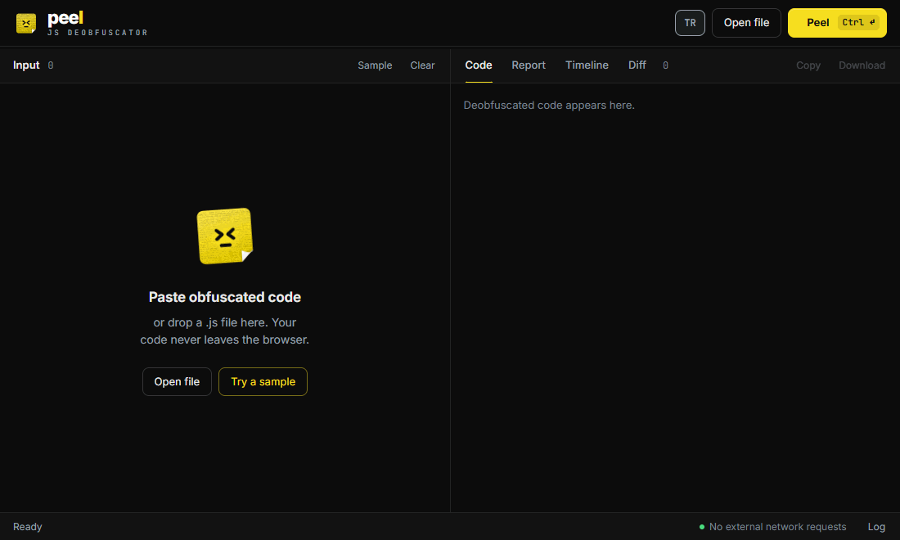
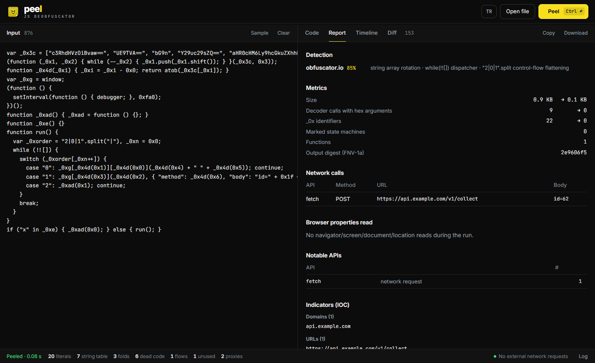
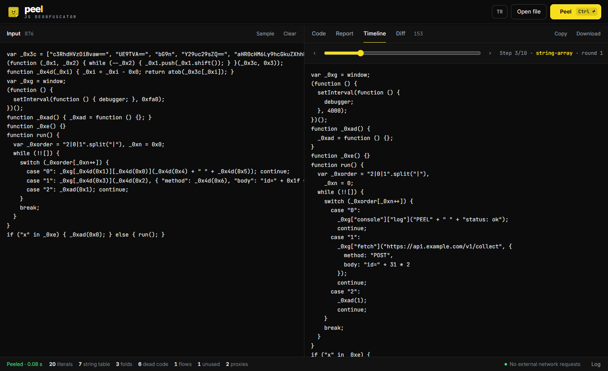
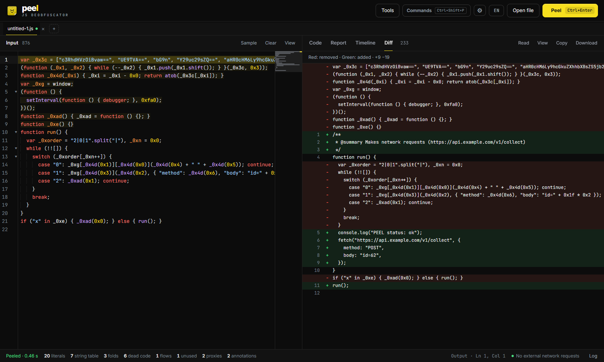
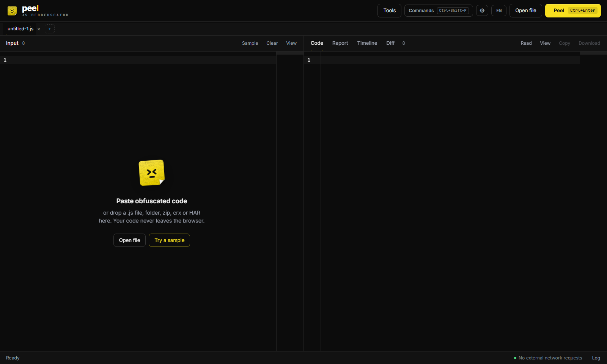

<p align="center">
  <picture>
    <source media="(prefers-color-scheme: dark)" srcset="public/peel-logo-horizontal-dark-3000.png">
    
  </picture>
</p>

<p align="center">
  <b>Peel the obfuscation off JavaScript, right in your browser.</b><br>
  Open source · MIT · free forever · your code never leaves your device
</p>

<p align="center">
  <a href="README.tr.md">Türkçe</a> ·
  <a href="#quick-start">Quick start</a> ·
  <a href="#how-it-works">How it works</a> ·
  <a href="ROADMAP.md">Roadmap</a> ·
  <a href="LICENSE">License</a>
</p>

<p align="center">
  
</p>

---

## Why PEEL

Most deobfuscators either pattern-match (fast, but give up on anything custom) or `eval` your input
(dangerous). PEEL does neither blindly:

- **Runs the code, safely.** Every step that needs execution happens inside a [QuickJS](https://github.com/justjake/quickjs-emscripten)
  sandbox in a Web Worker: memory and time limited, no network, no real DOM, fixed clock and randomness.
- **Proves its own changes.** After every pass the output is re-parsed and, by default, executed again;
  if the program's observable behaviour changes, that pass is rolled back automatically.
- **Reaches decoders other tools can't.** String decoders hidden inside closures (`M(0x2)`, js-confuser style)
  are captured at runtime and every call site is resolved with the real function.
- **Tells you what the code does.** A report lists the obfuscator it detected, the network calls the code
  attempted, the browser properties it fingerprinted, notable APIs and extracted indicators (IOCs).
- **Stays on your machine.** No server, no telemetry, no upload. The status bar shows how many external
  requests the page itself has made (zero).

On a real-world 83 KB js-confuser captcha script, one click resolves **2,289 / 2,289** string decoder calls,
**370 / 371** global proxy calls and unwraps the `Function()`, length-spoofing and no-op wrappers, in about 4 seconds.

## Screenshots

| Report | Timeline |
|---|---|
|  |  |
| **Diff** | **Start screen** |
|  |  |

## Quick start

Requirements: Node.js 20 or newer.

```bash
git clone https://github.com/LLCForge/Peel-JS.git
cd Peel-JS
npm install
npm run dev
```

Open <http://localhost:5173>, paste code (or drop a `.js` file, or click **Try a sample**) and press
**Peel** (`Ctrl + Enter`).

To build a static site you can host anywhere (GitHub Pages, Netlify, a USB stick):

```bash
npm run build
```

### Command line

The CLI uses the exact same engine and sandbox:

```bash
node bin/peel.js obfuscated.js -o clean.js --report report.json
```

```text
peel <input.js> [-o output.js] [--report report.json] [--quiet]
cat input.js | peel - > output.js
```

## What it handles today

| Pass | What it does |
|---|---|
| `normalize` | Fixes whitespace damage that stops the code from parsing (only when it does not parse) |
| `unpack` | Unwraps `Function("a", "body")(…)` |
| `predecoders` | Hooks `eval` and the `Function` constructor to peel packer, `eval(atob(…))`, `eval(unescape(…))`, JSFuck-style constructor chains, aaencode, jjencode |
| `literals` | `0x1f` → `31`, `"\x48"` → `"H"`, `a["b"]` → `a.b`, `Function("return this")()` → `globalThis` |
| `string-array` | String table + rotation IIFE + decoder, executed in the sandbox, every call replaced |
| `runtime-decoders` | Decoders hidden in closures are captured on first call; counter-based calls (`M(T + 273)`) resolved by runtime observation |
| `proxy` | `switch`-based proxies (`V("key")`, including js-confuser's `...O` form) and `window` aliases |
| `const-fold` | Side-effect-free expressions evaluated in the sandbox, only with unshadowed deterministic globals |
| `dead-code` | `debugger`, self-defending and debug-protection IIFEs, constant `if`/`?:`, `"k" in emptyFn` traps, no-op and `length`-spoofing wrappers |
| `opaque` | Moves literal constants into the tests that use them |
| `state-var` | `switch (P + Q + R)` → one state variable |
| `unflatten` | Turns loop-free state machines back into plain code by executing them with concrete state; state-independent conditions become real `if/else` (js-confuser 2.x included) |
| `vm` | Detects remaining state machines and annotates the transitions observed in a run |
| `control-flow` | Flattens `"2|0|1".split("|")` dispatchers in their static order |
| `unused` | Removes unused functions and variables |
| `rename` | `_0x1a2b` → `fn1`, `arg1`, `v1` (deterministic) |

The analysis report adds: obfuscator fingerprint (obfuscator.io, js-confuser, JSFuck, aaencode, jjencode,
packer, webpack), before/after metrics, attempted network calls (fetch, XHR, WebSocket, beacon, image,
script), browser property reads, notable APIs, IOCs (domains, URLs, IPs, emails, wallets, JWTs, embedded
key candidates), pass timings, rolled-back changes and a JSON export.

## How it works

```text
input
  → text passes        unwrap Function(), eval, packers
  → parse              Babel, no error recovery: a half-broken tree silently produces wrong code
  → open context       load the program once into a QuickJS sandbox
  → AST passes         repeated rounds until nothing changes
       after each pass: re-parse, re-run, compare console output → keep or roll back
  → prettier
  → analysis report
```

Every pass is a small module in [`src/passes/`](src/passes) with the signature
`export async function run(ast, ctx)`. Order and levels live in [`src/core/registry.js`](src/core/registry.js).

## Safety model and honest limits

- Untrusted code only ever runs inside QuickJS (WebAssembly) in a worker, with a memory cap and an
  interrupt deadline. **Stop** terminates the worker.
- Behaviour checks compare `console` output. Code that prints nothing gets a weaker check.
- Counter-based decoder calls are resolved by **observing one run**. A path the run did not take is not
  covered. The log says when a change came from observation.
- State machines are annotated, not yet rebuilt into plain code.
- Logic inside WebAssembly and strings encrypted with a key fetched from a server are out of reach.

## Roadmap

200 ideas, each with a status: **23 done, 14 partial, 163 planned**. See [ROADMAP.md](ROADMAP.md).
Highlights coming next: local-LLM variable naming (WebGPU, still offline), js-confuser parameter
recovery, multi-path exploration for state machines, Monaco editor.

## Contributing

```bash
npm test          # every fixture runs through the full pipeline with behaviour verification
npm test packer   # one fixture, with its log and output
```

A fixture is a `.js` file in [`test/fixtures/`](test/fixtures) with directive comments:

```js
// LEVEL: 3                      optional, default 4
// EXPECT: console.log("hi");    must appear in the output
// GONE: atob                    must not appear in the output
```

Pick an item from the roadmap, open an issue with its number, send a PR with a fixture that proves it.

## License

[MIT](LICENSE). Free to use, modify and redistribute, including commercially. No paid tier, no account,
no telemetry.
