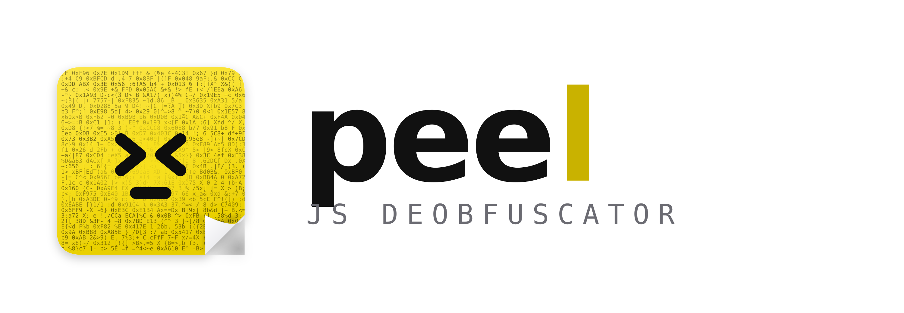
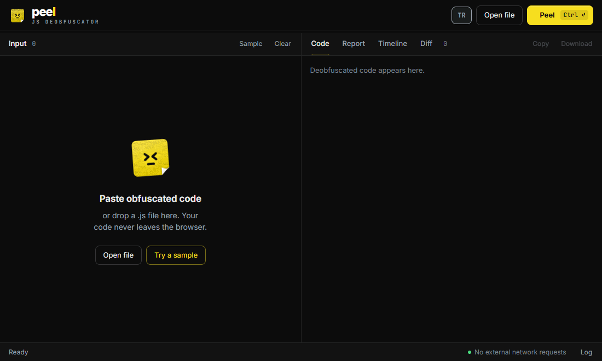
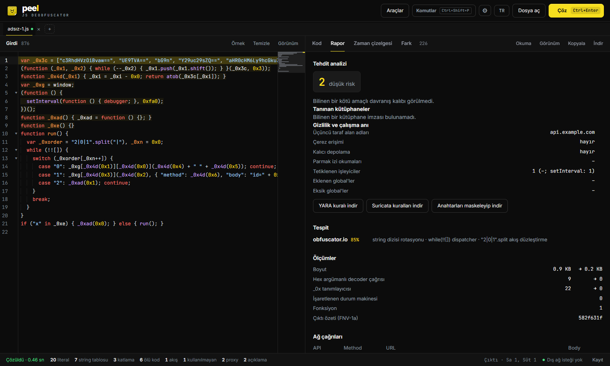
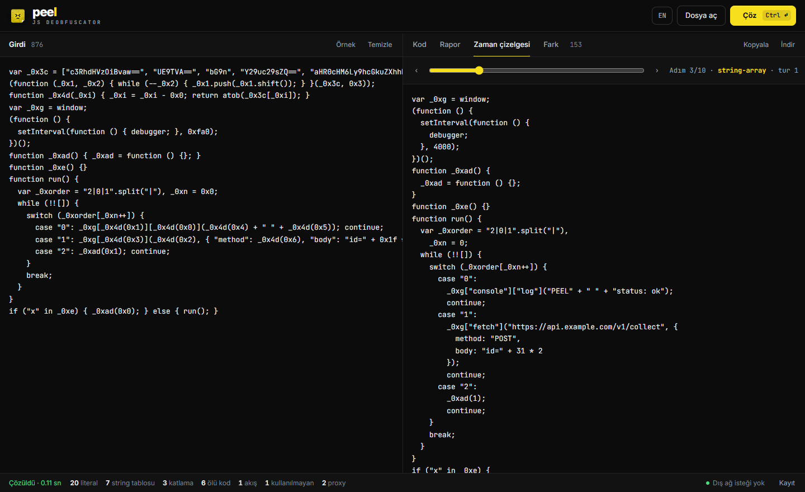
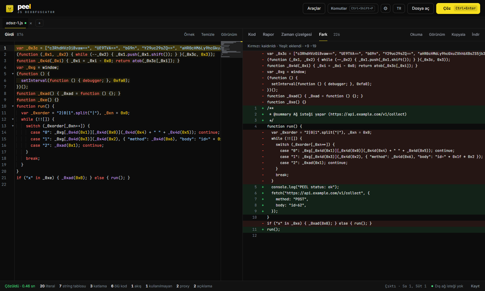
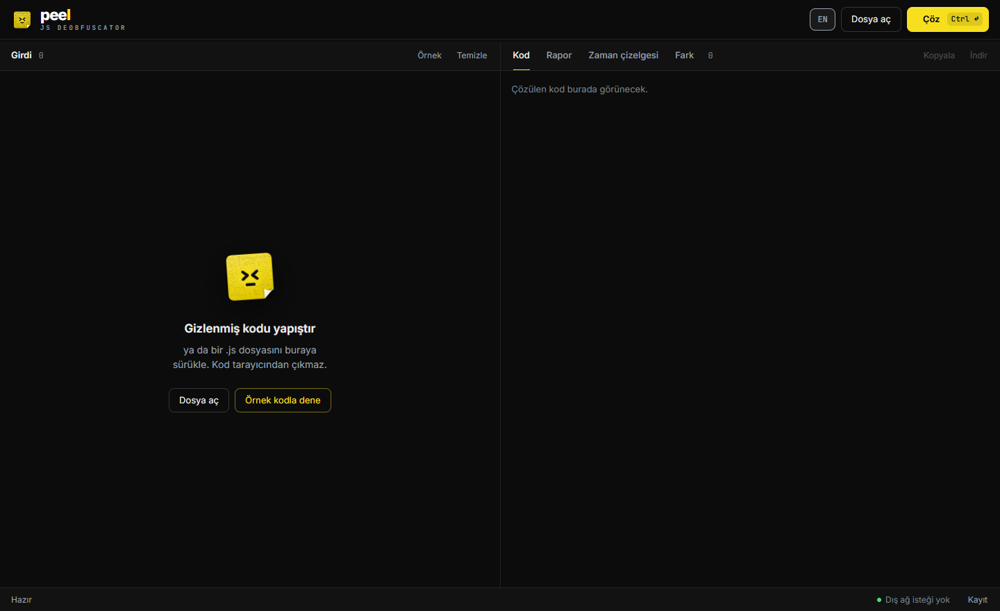

<p align="center">
  <picture>
    <source media="(prefers-color-scheme: dark)" srcset="public/peel-logo-horizontal-dark-3000.png">
    
  </picture>
</p>

<p align="center">
  <b>JavaScript'teki gizlemeyi tarayıcının içinde soy.</b><br>
  Açık kaynak · MIT · tamamen ücretsiz · kodun cihazından çıkmaz
</p>

<p align="center">
  <a href="README.md">English</a> ·
  <a href="#hızlı-başlangıç">Hızlı başlangıç</a> ·
  <a href="#nasıl-çalışır">Nasıl çalışır</a> ·
  <a href="ROADMAP.md">Yol haritası</a> ·
  <a href="LICENSE">Lisans</a>
</p>

<p align="center">
  
</p>

---

## Neden PEEL

Çoğu deobfuscator ya kalıp eşleştirir (hızlıdır ama özel bir şey görünce pes eder) ya da girdiyi
doğrudan `eval` eder (tehlikelidir). PEEL ikisini de körü körüne yapmaz:

- **Kodu güvenle çalıştırır.** Çalıştırma gereken her adım, Web Worker içindeki bir
  [QuickJS](https://github.com/justjake/quickjs-emscripten) sandbox'ında olur: bellek ve süre sınırlı,
  ağ yok, gerçek DOM yok, saat ve rastgelelik sabit.
- **Kendi değişikliğini kanıtlar.** Her pass'ten sonra çıktı yeniden parse edilir ve yeniden çalıştırılır;
  programın gözlenebilir davranışı değiştiyse o pass otomatik geri alınır.
- **Başka araçların ulaşamadığı decoder'lara ulaşır.** Closure içine gizlenmiş string decoder'ları
  (`M(0x2)`, js-confuser tarzı) çalışma anında yakalanır ve her çağrı gerçek fonksiyonla çözülür.
- **Kodun ne yaptığını söyler.** Rapor; tespit edilen obfuscator'ı, kodun denediği ağ çağrılarını,
  okuduğu tarayıcı özelliklerini (fingerprint), dikkat çeken API'leri ve çıkarılan göstergeleri (IOC) listeler.
- **Cihazında kalır.** Sunucu yok, telemetri yok, yükleme yok. Durum çubuğu, sayfanın kendisinin
  yaptığı dış istek sayısını gösterir (sıfır).

83 KB'lık gerçek bir js-confuser captcha script'inde tek tıkla **2.289 / 2.289** string decoder çağrısı,
**370 / 371** global proxy çağrısı çözülür; `Function()`, length sahteciliği ve boş sarmalayıcılar
yaklaşık 4 saniyede sökülür.

## Ekran görüntüleri

| Rapor | Zaman çizelgesi |
|---|---|
|  |  |
| **Fark** | **Başlangıç ekranı** |
|  |  |

## Hızlı başlangıç

Gereksinim: Node.js 20 ya da üstü.

```bash
git clone https://github.com/LLCForge/Peel-JS.git
cd Peel-JS
npm install
npm run dev
```

<http://localhost:5173> adresini aç, kodu yapıştır (ya da `.js` dosyasını sürükle, ya da
**Örnek kodla dene**'ye bas) ve **Çöz**'e bas (`Ctrl + Enter`).

Her yerde barındırabileceğin statik site (GitHub Pages, Netlify, bir USB bellek) üretmek için:

```bash
npm run build
```

### Komut satırı

CLI, tarayıcıdakiyle birebir aynı motoru ve sandbox'ı kullanır:

```bash
node bin/peel.js obfuscated.js -o clean.js --report report.json
```

```text
peel <girdi.js> [-o çıktı.js] [--report rapor.json] [--quiet]
cat girdi.js | peel - > çıktı.js
```

## Bugün neleri çözüyor

| Pass | Görevi |
|---|---|
| `normalize` | Kodun parse edilmesini engelleyen boşluk bozulmalarını düzeltir (yalnızca parse edilemiyorsa) |
| `unpack` | `Function("a", "gövde")(…)` sarmalayıcısını açar |
| `predecoders` | `eval` ve `Function` kurucusunu yakalayarak packer, `eval(atob(…))`, `eval(unescape(…))`, JSFuck tarzı constructor zincirleri, aaencode, jjencode katmanlarını soyar |
| `literals` | `0x1f` → `31`, `"\x48"` → `"H"`, `a["b"]` → `a.b`, `Function("return this")()` → `globalThis` |
| `string-array` | String tablosu + rotasyon + decoder'ı sandbox'ta çalıştırıp her çağrıyı değiştirir |
| `runtime-decoders` | Closure içindeki decoder'ları ilk çağrıda yakalar; sayaca bağlı çağrıları (`M(T + 273)`) çalışma anı gözlemiyle çözer |
| `proxy` | `switch` tabanlı proxy'ler (`V("anahtar")`, js-confuser'ın `...O` biçimi dahil) ve `window` alias'ları |
| `const-fold` | Yan etkisiz ifadeleri sandbox'ta değerlendirir; yalnızca gölgelenmemiş deterministik global'lerle |
| `dead-code` | `debugger`, self-defending ve debug koruması IIFE'leri, sabit `if`/`?:`, `"k" in boşFn` tuzakları, boş ve `length` sarmalayıcıları |
| `opaque` | Literal sabitleri onları kullanan testlerin içine taşır |
| `state-var` | `switch (P + Q + R)` → tek durum değişkeni |
| `unflatten` | Döngüsüz durum makinelerini somut durumla yürüterek düz koda çevirir; durumdan bağımsız koşullar gerçek `if/else` olur (js-confuser 2.x dahil) |
| `vm` | Kalan durum makinelerini tespit edip bir çalıştırmada gözlenen geçişleri yorum olarak yazar |
| `control-flow` | `"2|0|1".split("|")` dispatcher'larını statik sırayla düzleştirir |
| `unused` | Kullanılmayan fonksiyon ve değişkenleri kaldırır |
| `rename` | `_0x1a2b` → `fn1`, `arg1`, `v1` (deterministik) |

Analiz raporu ayrıca şunları verir: obfuscator parmak izi (obfuscator.io, js-confuser, JSFuck, aaencode,
jjencode, packer, webpack), önce/sonra ölçümleri, denenen ağ çağrıları (fetch, XHR, WebSocket, beacon,
image, script), okunan tarayıcı özellikleri, dikkat çeken API'ler, IOC'ler (alan adı, URL, IP, e-posta,
cüzdan, JWT, gömülü anahtar adayları), pass süreleri, geri alınan değişiklikler ve JSON dışa aktarma.

## Nasıl çalışır

```text
girdi
  → metin pass'leri    Function(), eval ve packer sarmalayıcılarını aç
  → parse              Babel, hata kurtarmasız: yarı bozuk ağaç sessizce yanlış kod üretir
  → bağlam aç          programı bir kez QuickJS sandbox'ına yükle
  → AST pass'leri      değişiklik durana kadar tur tur
       her pass'ten sonra: yeniden parse, yeniden çalıştır, console çıktısını karşılaştır → koru ya da geri al
  → prettier
  → analiz raporu
```

Her pass, [`src/passes/`](src/passes) altında `export async function run(ast, ctx)` imzasına sahip küçük
bir modüldür. Sıra ve seviyeler [`src/core/registry.js`](src/core/registry.js) içinde.

## Güvenlik modeli ve dürüst sınırlar

- Güvenilmeyen kod yalnızca bir worker içindeki QuickJS'te (WebAssembly), bellek sınırı ve kesme
  süresiyle çalışır. **Durdur** worker'ı sonlandırır.
- Davranış kontrolü `console` çıktısını karşılaştırır. Hiç çıktı üretmeyen kodda kontrol zayıflar.
- Sayaca bağlı decoder çağrıları **tek bir çalıştırma gözlenerek** çözülür. Çalıştırmanın girmediği yol
  kapsanmaz. Log, değişikliğin gözlemden geldiğini ayrıca belirtir.
- Durum makineleri işaretlenir ama henüz düz koda çevrilmez.
- WebAssembly içindeki mantık ve anahtarı sunucudan gelen şifreli string'ler kapsam dışıdır.

## Entegrasyonlar

Aşağıdakilerin hepsi yerelde çalışır. Kodun hiçbir yere yüklenmez; sunucular yalnızca `127.0.0.1`'e bağlanır.

**CLI.** Toplu iş (`peel src/ --out-dir out`), `--json`, `--sarif`, `--html` (önce/sonra raporu), `--git <dizin>` (her pass bir commit),
`--watch`, `--style auto` (`.prettierrc` / `.editorconfig` / `.eslintrc.json` kurallarına uyar), `--rules`, `--plugin` + `--trust`,
`--project dosya.peel`, `--semgrep`, `--history`, `--fail-on high`, yapılandırma dosyası `peel.config.json`.
Çıkış kodları: 0 tamam, 1 hata, 2 kullanım, 3 değişiklik, 4 risk eşiği. Alt komutlar (`peel <komut> --help`):

| Komut | |
|---|---|
| `peel diff eski.js yeni.js -D` | yeniden adlandırmayı yok sayan semantik diff, sürümler arası fonksiyon eşleştirme, yeni teknik uyarısı; `--port-names çıktı.js` adları taşır |
| `peel track <dosya\|url>` | script'i izler, her yeni sürümü çözer ve neyin değiştiğini raporlar |
| `peel history` | yerel çözüm geçmişi (`~/.peel`), etiket ve notlar, "daha önce görüldü" sorgusu |
| `peel serve` | 127.0.0.1 üzerinde Bearer token'lı REST API (`/v1/deobfuscate`, `/v1/diff`, `/v1/sarif`) |
| `peel bot` | Slack / Discord eğik çizgi komutu botu (imza doğrulamalı) |
| `peel asar app.asar -o dizin -D` | Electron arşivini açar, script'lerini çözer |
| `peel symbols a.js b.js` | dosyalar arası sembol haritası; `--rename eski=yeni` tüm dosyalarda adlandırır |
| `peel share` / `unshare` | kodu URL'nin # kısmında taşıyan, isteğe bağlı AES-GCM ile şifreli bağlantı |
| `peel plugin keygen\|sign\|verify` | Ed25519 imzalı pass eklentileri |
| `peel explain`, `techniques`, `learn`, `ctf`, `obfuscate --test`, `anonymize`, `changelog` | öğrenme araçları |

**Kütüphane.** `npm i peel-js`, ardından `import { peel, deobfuscate, analyze, semanticDiff } from 'peel-js'` (tipler dahil;
yalnızca Node'a özgü yardımcılar `peel-js/node` altında). **GitHub Action:** `uses: LLCForge/Peel-JS@main`, `files: dist/**/*.js`
(SARIF ve adım özeti üretir). **Editör ve araçlar:** `extensions/vscode` (VS Code), `extensions/mitmproxy`, `extensions/burp`,
`extensions/jupyter`, `extensions/observable`, `extensions/semgrep`. **Masaüstü:** `src-tauri`
(`cargo install tauri-cli --version ^2 && cargo tauri build`). Web uygulaması PWA olarak çevrimdışı çalışır; **Araçlar**
penceresinde karşılaştırma, geçmiş, paylaşım, `.asar` dosyaları, kurallar/eklentiler ve eğitim / CTF / ansiklopedi bulunur.

## Yol haritası

Her birinin durumu belli 200 fikir: **23 yapıldı, 14 kısmen, 163 planlandı**. Bkz. [ROADMAP.md](ROADMAP.md).
Sıradakiler: yerel LLM ile değişken adlandırma (WebGPU, yine çevrimdışı), js-confuser parametre
kurtarma, durum makineleri için çoklu yol keşfi, Monaco editör.

## Katkı

```bash
npm test          # her fixture davranış doğrulamasıyla tüm pipeline'dan geçer
npm test packer   # tek fixture, log ve çıktısıyla
```

Fixture, [`test/fixtures/`](test/fixtures) içinde yönerge yorumları olan bir `.js` dosyasıdır:

```js
// LEVEL: 3                      isteğe bağlı, varsayılan 4
// EXPECT: console.log("hi");    çıktıda bulunmalı
// GONE: atob                    çıktıda bulunmamalı
```

Yol haritasından bir madde seç, numarasıyla bir issue aç ve onu kanıtlayan bir fixture ile PR gönder.

## Lisans

[MIT](LICENSE). Kullanmak, değiştirmek ve ticari dahil yeniden dağıtmak serbest. Ücretli sürüm yok,
hesap yok, telemetri yok.
